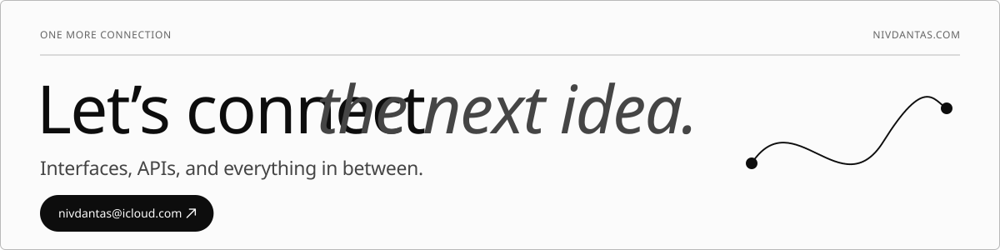

<a href="https://nivdantas.com">
  <picture>
    <source media="(prefers-color-scheme: dark)" srcset="assets/header-dark.svg">
    
  </picture>
</a>

  <picture>
    <source media="(prefers-color-scheme: dark)" srcset="https://readme-typing-svg.demolab.com?font=Geist+Mono&size=15&duration=2600&pause=1600&color=7F9EF0&center=true&vCenter=true&width=640&height=28&lines=The+interface+someone+uses.;The+API+behind+it.;The+data+that+makes+it+useful.">
    
  </picture>

  
  
  
  

### Hi, I'm Niv

I'm a software engineer from Brazil. I build the interface someone uses, the API behind it, and the automations and data that make it useful.

- **Right now.** Svelte interfaces and n8n automations with **Bellus** and **Worktables**, plus independent work on web apps, stream metrics, and AI integrations.
- **Before.** End-to-end apps and process automation at the Amazonas State Court of Accounts, and React, React Native, and SQL apps for R&D projects at PAPE / Samsung.
- **Studied.** Software Engineering at the Federal Institute of Amazonas (IFAM).
- **Tools.** React, Svelte, React Native, and TypeScript on the front; Express, Laravel, PHP, REST, and SQL behind it; n8n, webhooks, Gemini, SQLite, and Docker around it.

### What I'm building

<a href="https://github.com/nivdantas/nv-code">
  <picture>
    <source media="(prefers-color-scheme: dark)" srcset="assets/project-nv-code-dark.svg">
    
  </picture>
</a>
<a href="https://github.com/nivdantas/bolota">
  <picture>
    <source media="(prefers-color-scheme: dark)" srcset="assets/project-bolota-dark.svg">
    
  </picture>
</a>
<a href="https://github.com/nivdantas/n-store">
  <picture>
    <source media="(prefers-color-scheme: dark)" srcset="assets/project-n-store-dark.svg">
    
  </picture>
</a>
<a href="https://github.com/nivdantas/takostreak">
  <picture>
    <source media="(prefers-color-scheme: dark)" srcset="assets/project-takostreak-dark.svg">
    
  </picture>
</a>

### Usage

<picture>
  <source media="(prefers-color-scheme: dark)" srcset="https://raw.githubusercontent.com/nivdantas/nivdantas/output/usage-dark.svg">
  
</picture>

<picture>
  <source media="(prefers-color-scheme: dark)" srcset="https://raw.githubusercontent.com/nivdantas/nivdantas/output/snake-dark.svg">
  
</picture>

<b>Em português</b>

 

Sou o Niv, engenheiro de software no Brasil. Desenvolvo a interface, a API e as conexões entre elas.

Hoje crio interfaces em Svelte e automações com n8n na Bellus e na Worktables, e trabalho de forma independente com aplicações web, métricas de transmissão e integrações com IA. Antes, desenvolvi aplicações e automações no Tribunal de Contas do Amazonas e projetos de P&D no PAPE/Samsung. Sou formado em Engenharia de Software pelo IFAM.

Conheça mais em [nivdantas.com](https://nivdantas.com).

<a href="mailto:nivdantas@icloud.com">
  <picture>
    <source media="(prefers-color-scheme: dark)" srcset="assets/footer-dark.svg">
    
  </picture>
</a>

  
   
  Drawn in NV-CODE's Tako Ink look. The tako comes from <a href="https://github.com/nivdantas/takostreak">TakoStreak</a>; the art is rebuilt by <code>scripts/build_assets.py</code>.

