<a href="https://nivdantas.com">
  <picture>
    <source media="(prefers-color-scheme: dark)" srcset="assets/header-dark.svg">
    
  </picture>
</a>

  <picture>
    <source media="(prefers-color-scheme: dark)" srcset="https://readme-typing-svg.demolab.com?font=Geist+Mono&size=15&duration=2600&pause=1600&color=9C9C9C&center=true&vCenter=true&width=640&height=28&lines=The+interface+someone+uses.;The+API+behind+it.;The+data+that+makes+it+useful.">
    
  </picture>

  
  
  

### The person behind the code

I'm Nivaldo Dantas, a software engineering graduate from IFAM. My work has taken me from research projects with PAPE/Samsung to applications and process automation at the Amazonas State Court of Accounts.

Today I build Svelte interfaces and n8n automations with **Bellus** and **Worktables**, and I work independently on web applications, stream metrics, and AI integrations. I like connecting the pieces: the interface someone uses, the API behind it, and the data that makes it useful.

<picture>
  <source media="(prefers-color-scheme: dark)" srcset="assets/connections-dark.svg">
  
</picture>

### Selected work

<a href="https://github.com/nivdantas/bolota">
  <picture>
    <source media="(prefers-color-scheme: dark)" srcset="assets/project-bolota-dark.svg">
    
  </picture>
</a>

<a href="https://github.com/nivdantas/n-store">
  <picture>
    <source media="(prefers-color-scheme: dark)" srcset="assets/project-n-store-dark.svg">
    
  </picture>
</a>

<a href="https://github.com/nivdantas/takostreak">
  <picture>
    <source media="(prefers-color-scheme: dark)" srcset="assets/project-takostreak-dark.svg">
    
  </picture>
</a>

### The journey

| When | Where | What |
| :-- | :-- | :-- |
| Nov 2026 — Present | **Bellus** · Software Engineer | Svelte interfaces and n8n workflow automation. |
| May 2026 — Present | **Worktables** · Software Engineer | Svelte applications and n8n automations that connect a team's tools, APIs, and data. |
| 2026 — Present | **Independent work** · Software Engineer | Stream metric overlays, APIs for continuous client feedback, and Gemini-powered automation, including Bolota. |
| 2024 — 2025 | **Amazonas State Court of Accounts** · Software Engineering Intern | End-to-end applications, internal process automation, and the annual LGPD assessment. |
| 2021 — 2024 | **PAPE / Samsung** · Software Research Engineer | React, React Native, and SQL applications for R&D projects, with REST APIs and software testing. |
| 2020 — 2025 | **Federal Institute of Amazonas (IFAM)** | Bachelor's in Software Engineering. Major GPA 9.0. |

### One day at a time

  <picture>
    <source media="(prefers-color-scheme: dark)" srcset="https://streak-stats.demolab.com?user=nivdantas&hide_border=true&border_radius=6&background=0D0D0D&stroke=454545&ring=FBFBFB&fire=FBFBFB&currStreakNum=FBFBFB&sideNums=FBFBFB&currStreakLabel=FBFBFB&sideLabels=9C9C9C&dates=828282">
    
  </picture>

<picture>
  <source media="(prefers-color-scheme: dark)" srcset="https://raw.githubusercontent.com/nivdantas/nivdantas/output/snake-dark.svg">
  
</picture>

<b>Em português</b>

 

**Código com cuidado. Um toque pessoal.** Sou o Niv, formado em Engenharia de Software pelo IFAM. Desenvolvo a interface, a API e as conexões entre elas.

Minha trajetória passa por projetos de pesquisa no PAPE/Samsung e pelo desenvolvimento de aplicações e automações no Tribunal de Contas do Amazonas. Hoje, crio interfaces em Svelte e automações com n8n na Bellus e na Worktables, e trabalho de forma independente com aplicações web, métricas de transmissão e integrações com IA.

Conheça mais em [nivdantas.com](https://nivdantas.com).

<a href="mailto:nivdantas@icloud.com">
  <picture>
    <source media="(prefers-color-scheme: dark)" srcset="assets/footer-dark.svg">
    
  </picture>
</a>

  

